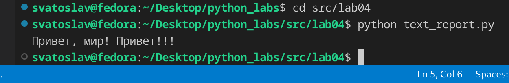
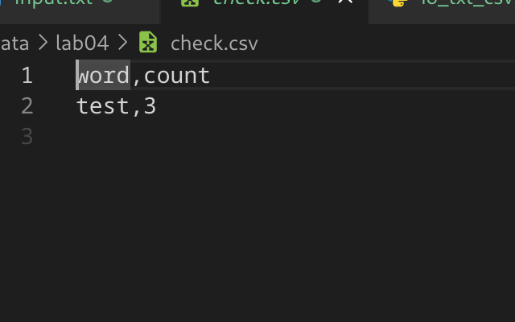
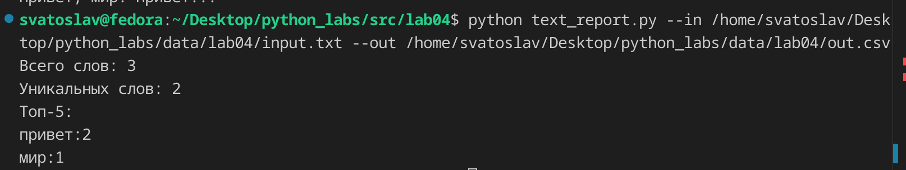
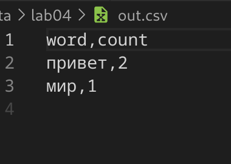
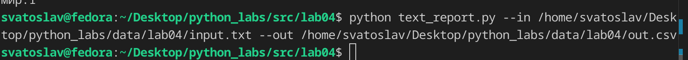
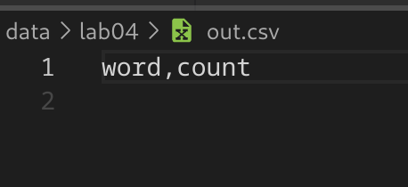
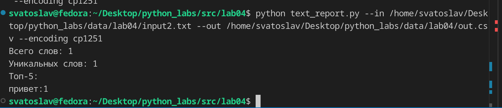
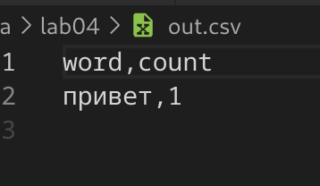

## ЛР3 — Тексты и частоты слов (словарь/множество)

## Задание A

read_text — преобразует путь в объект Path и вызывает его метод read_text, который открывает файл, читает всё содержимое и возвращает его как строку.

write_csv — открывает файл на запись, создаёт csv.writer и построчно записывает данные: сначала заголовок (если он передан), затем каждую строку. Перед записью проверяет, что все строки имеют одинаковую длину (равную длине заголовка или первой строки), иначе выбрасывает ошибку.

ensure_parent_dir — разбивает путь на части, отбрасывает имя файла и проверяет, существует ли оставшаяся директория. Если её нет — создаёт через mkdir.

```py
import csv
from collections.abc import Iterable, Sequence
from pathlib import Path


def read_text(path: str | Path, encoding: str = "utf-8") -> str:
    """
    Reads text from file

    Args: 
        path: str | Path
        encoding = "utf-8": str

    Returns: 
        Type: str

    Exceptions:
        FileNotFoundError
        UnicodeDecodeError
    """
    p = Path(path)
    return p.read_text(encoding=encoding)

def write_csv(rows: Iterable[Sequence], path: str | Path,
    header: tuple[str, ...] | None = None) -> None:
    """
    Writes CSV-table

    Args:
        rows: Iterable[Sequence]
        path: str | Path
        header: tuple[str, ...] | None = None

    Returns:
        None

    Exceptions:
        ValueError: rows must be similar length.
    """
    p = Path(path)
    rows = list(rows)
    with p.open("w", newline="", encoding="utf-8") as f:
        w = csv.writer(f)
        if header is not None:
            w.writerow(header)
        
        if len(rows) != 0:
            expected_len = len(header) if header is not None else len(rows[0])
            for r in rows:
                if len(r) != expected_len:
                    raise ValueError("rows must be similar length.")
                w.writerow(r)

def ensure_parent_dir(path: str | Path) -> None:
    """
    Creates parent directory.

    Args:
    path: str | Path

    Returns:
        None
    """
    path = Path(path)
    parts = path.parts
    if not Path(*parts[:-1]).exists():
        Path(*parts[:-1]).mkdir()
```
### тест кейсы



## Задание B

frequencies_from_text(text) — принимает готовый текст, прогоняет его через normalize (приведение к нижнему регистру, очистка от лишних символов) и tokenize (разбиение на слова). Возвращает Counter — словарь, где ключ — слово, значение — сколько раз оно встретилось.

sorted_word_counts(freq) — берёт словарь частот и сортирует его элементы. Ключ сортировки (-kv[1], kv[0]) означает: сначала по убыванию частоты, а при одинаковой частоте — по возрастанию слова (алфавитный порядок). Возвращает список кортежей (слово, частота).

args_parse() — настраивает argparse для приёма аргументов из командной строки. Определяет три опции: --in/-i (путь к входному файлу, обязателен), --out/-o (путь к выходному CSV, обязателен) и --encoding/-e (кодировка, по умолчанию utf-8). Возвращает объект с разобранными значениями.

main() — точка входа программы. Сначала получает аргументы через args_parse, затем читает текст из входного файла (read_text). Далее нормализует и токенизирует текст, считает частоты (count_freq), сортирует их (sorted_word_counts) и превращает в обычный dict. После этого создаёт родительскую директорию для выходного файла (ensure_parent_dir) и записывает CSV с заголовком word,count (write_csv). В конце, если текст не пустой, выводит в консоль общее число слов, число уникальных слов и топ-5 самых частых через top_n.
```py
import argparse
import os
from collections import Counter
from sys import path, stdin

from io_txt_csv import ensure_parent_dir, read_text, write_csv

path.insert(0, os.path.join(os.path.dirname(__file__), '..', '..'))

from src.lib.text import count_freq, normalize, tokenize, top_n


def frequencies_from_text(text: str) -> dict[str, int]:
    tokens = tokenize(normalize(text))
    return Counter(tokens)

def sorted_word_counts(freq: dict[str, int]) -> list[tuple[str, int]]:
    return sorted(freq.items(), key=lambda kv: (-kv[1], kv[0]))

def args_parse():
    parser = argparse.ArgumentParser()

    parser.add_argument(
         "--in", "-i",
        dest="input_file",
        required=True
    )
    parser.add_argument(
         "--out", "-o",
        dest="out_file",
        required=True
    )
    parser.add_argument(
         "--encoding", "-e",
        dest="encoding",
        default="utf-8",
        required=False
    )
    return parser.parse_args()

def main():
    args = args_parse()
    text = read_text(args.input_file, encoding=args.encoding)
    nrm_text = normalize(text)
    tokens = tokenize(nrm_text)
    freqs = dict(sorted_word_counts(count_freq(tokens)))


    ensure_parent_dir(args.out_file)
    write_csv(freqs.items(), args.out_file, header=("word", "count"))

    if text != "":
        top_5 = top_n(freqs, 5)
        print(f"Всего слов: {len(tokens)}\nУникальных слов: {len(freqs.keys())}\nТоп-5:")
        for item in top_5:
            w, f = item
            print(f"{w}:{f}")

if __name__ == "__main__":
    main()
```

### тест кейсы
не пустой файл


пустой файл


не стандратная кодировка


