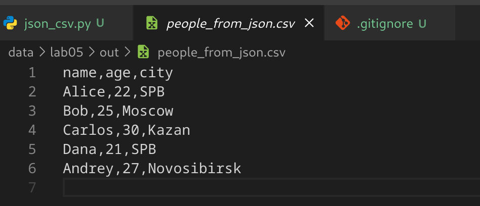
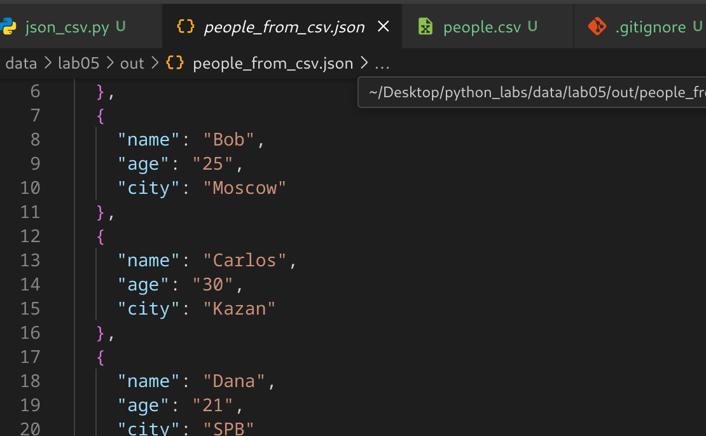
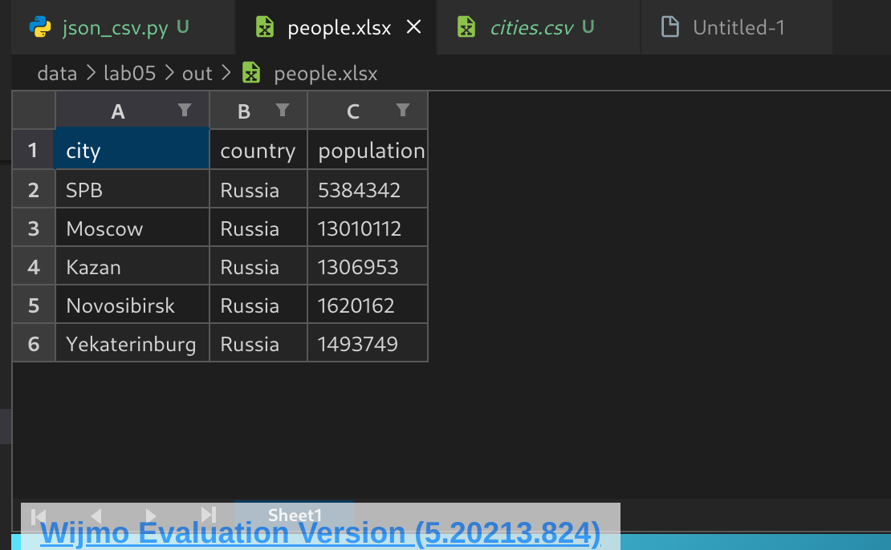

## ЛР5 —   JSON и конвертации (JSON↔CSV, CSV→XLSX)

## Задание A

_check_suffix(path, expected) — проверяет расширение файла (без учёта регистра) и кидает ValueError, если не совпало. Нужна, чтобы не дублировать проверку в двух функциях.

json_to_csv(json_path, csv_path) — читает JSON, проверяет, что это непустой список словарей, и пишет CSV с заголовком. Колонки — объединение всех ключей, пропуски заполняются пустой строкой; ошибки — FileNotFoundError и ValueError.

csv_to_json(csv_path, json_path) — читает CSV с обязательным заголовком и превращает каждую строку в словарь (значения остаются строками). Пишет JSON через json.dump(..., ensure_ascii=False, indent=2); ошибки — FileNotFoundError и ValueError.

```py
import csv
import json
from pathlib import Path


def _check_suffix(path: Path, expected: str) -> None:
    """Проверяет расширение файла (регистронезависимо)."""
    if path.suffix.lower() != expected:
        raise ValueError(
            f"Неверный тип файла: {path.name}. Ожидалось расширение {expected}"
        )


def json_to_csv(json_path: str, csv_path: str) -> None:
    """
    Преобразует JSON-файл в CSV.

    Args:
        json_path: str путь
        csv_path:  str путь

    Returns:
        None

    Exceptions:
        FileNotFoundError: если входной файл отсутствует
        ValueError: пустой JSON, неверная структура, неверное расширение
    """
    jp = Path(json_path)
    cp = Path(csv_path)

    _check_suffix(jp, ".json")
    _check_suffix(cp, ".csv")

    if not jp.exists():
        raise FileNotFoundError(f"Файл не найден: {jp}")

    with jp.open(encoding="utf-8") as f:
        try:
            data = json.load(f)
        except json.JSONDecodeError as e:
            raise ValueError(f"Некорректный JSON: {e}") from e

    if not data:
        raise ValueError("Пустой JSON или неподдерживаемая структура")

    if not isinstance(data, list):
        raise ValueError("Пустой JSON или неподдерживаемая структура")

    for item in data:
        if not isinstance(item, dict):
            raise ValueError("JSON должен быть списком словарей")

    fieldnames: list[str] = []
    seen: set[str] = set()
    for obj in data:
        for key in obj.keys():
            if key not in seen:
                seen.add(key)
                fieldnames.append(key)

    cp.parent.mkdir(parents=True, exist_ok=True)

    with cp.open("w", newline="", encoding="utf-8") as f:
        writer = csv.DictWriter(f, fieldnames=fieldnames, restval="")
        writer.writeheader()
        for obj in data:
            writer.writerow({k: obj.get(k, "") for k in fieldnames})


def csv_to_json(csv_path: str, json_path: str) -> None:
    """
    Преобразует CSV в JSON (список словарей).

    Args:
        csv_path:  str путь
        json_path: str путь

    Returns:
        None

    Exceptions:
        FileNotFoundError: если входной файл отсутствует
        ValueError: пустой CSV, отсутствует заголовок, неверное расширение
    """
    cp = Path(csv_path)
    jp = Path(json_path)

    _check_suffix(cp, ".csv")
    _check_suffix(jp, ".json")

    if not cp.exists():
        raise FileNotFoundError(f"Файл не найден: {cp}")

    with cp.open(encoding="utf-8", newline="") as f:
        reader = csv.DictReader(f)
        if reader.fieldnames is None:
            raise ValueError("CSV без заголовка")
        fieldnames = reader.fieldnames
        rows = [dict(row) for row in reader]

    if not rows:
        raise ValueError("Пустой CSV")

    jp.parent.mkdir(parents=True, exist_ok=True)

    with jp.open("w", encoding="utf-8") as f:
        json.dump(rows, f, ensure_ascii=False, indent=2)
```

## Задание B

_check_suffix(path, expected)

Проверяет расширение файла (без учёта регистра) и кидает ValueError, если не совпало. Нужна, чтобы не дублировать проверку .csv/.xlsx в функции.
csv_to_xlsx(csv_path, xlsx_path)

Читает CSV, требует непустой заголовок (иначе ValueError) и создаёт книгу Excel с листом Sheet1. Заголовок пишется жирным, строки добавляются через ws.append, а ширина каждой колонки выставляется по максимальной длине текста, но не меньше 8 символов.

```py
import csv
from pathlib import Path

from openpyxl import Workbook
from openpyxl.styles import Font


def _check_suffix(path: Path, expected: str) -> None:
    if path.suffix.lower() != expected:
        raise ValueError(
            f"Неверный тип файла: {path.name}. Ожидалось расширение {expected}"
        )


def csv_to_xlsx(csv_path: str, xlsx_path: str) -> None:
    """
    Конвертирует CSV в XLSX.

    Args:
        csv_path:  str путь
        xlsx_path: str путь

    Returns:
        None

    Exceptions:
        FileNotFoundError: если CSV отсутствует
        ValueError: пустой CSV, отсутствует заголовок, неверное расширение
    """
    cp = Path(csv_path)
    xp = Path(xlsx_path)

    _check_suffix(cp, ".csv")
    _check_suffix(xp, ".xlsx")

    if not cp.exists():
        raise FileNotFoundError(f"Файл не найден: {cp}")

    with cp.open(encoding="utf-8", newline="") as f:
        reader = csv.reader(f)
        try:
            header = next(reader)
        except StopIteration:
            raise ValueError("Пустой CSV")

        rows = [row for row in reader]

    if not header or all(cell == "" for cell in header):
        raise ValueError("CSV без заголовка")

    wb = Workbook()
    ws = wb.active
    ws.title = "Sheet1"

    ws.append(header)
    for cell in ws[1]:
        cell.font = Font(bold=True)

    for row in rows:
        ws.append(row)

    for col_idx, _ in enumerate(header, start=1):
        max_len = 8
        for row_idx in range(1, ws.max_row + 1):
            val = ws.cell(row=row_idx, column=col_idx).value
            if val is not None:
                max_len = max(max_len, len(str(val)))
        col_letter = ws.cell(row=1, column=col_idx).column_letter
        ws.column_dimensions[col_letter].width = max_len

    xp.parent.mkdir(parents=True, exist_ok=True)
    wb.save(xp)
```

### тесты

комманды запуска 

```bash 
python -c "from src.lab05.json_csv import json_to_csv; json_to_csv('data/lab05/samples/people.json', 'data/lab05/out/people_from_json.csv')"

python -c "from src.lab05.json_csv import json_to_csv; json_to_csv('data/lab05/samples/people.json', 'data/lab05/out/people_from_json.csv')"

python -c "from src.lab05.csv_xlsx import csv_to_xlsx; csv_to_xlsx('data/lab05/samples/cities.csv', 'data/lab05/out/people.xlsx')"
```

для удобства сделал test.py

```py
import sys
from pathlib import Path

ROOT = Path(__file__).resolve().parents[2]
sys.path.insert(0, str(ROOT))

from src.lab05.csv_xlsx import csv_to_xlsx
from src.lab05.json_csv import csv_to_json, json_to_csv

DATA = ROOT / "data" / "lab05"

json_to_csv(DATA / "samples/people.json", DATA / "out/people_from_json.csv")
csv_to_json(DATA / "samples/people.csv", DATA / "out/people_from_csv.json")
csv_to_xlsx(DATA / "samples/cities.csv", DATA / "out/people.xlsx")
```

JSON > CSV



CSV > JSON


CSV > XLSX
