# lab06
## cli_text.py
```py
import argparse
from pathlib import Path

from src.lib.text import normalize, tokenize, count_freq, top_n


def cat(path: str, number: bool) -> None:
    try: 
        file = Path(path)
        with file.open(encoding = 'utf-8') as f:
            number_line = 1
            for line in f:
                line = line.strip('\n')
                if number: 
                    print(number_line, line)
                else:
                    print(line)
                number_line+=1
    except FileNotFoundError:
        print("Файл не найден")


def stats(path: str, top: int) -> None:
    try:
        file = Path(path)
        with file.open(encoding = 'utf-8') as f:
            text = f.read()
            freq = count_freq(tokenize(normalize(text)))
            for key, value in top_n(freq, top):
                print(f'{key}: {value}')
    except FileNotFoundError:
        print("Файл не найден")


def main():
    parser = argparse.ArgumentParser(description="CLI‑утилиты")
    subparsers = parser.add_subparsers(dest="command")

    cat_parser = subparsers.add_parser("cat", help="Вывод содержания файла")
    cat_parser.add_argument("--input", required=True, help="Путь к файлу")
    cat_parser.add_argument("-n", action="store_true", help="Нумеровать строки")

    stats_parser = subparsers.add_parser("stats", help="Вывод частоты слов")
    stats_parser.add_argument("--input", required=True, help="Путь к файлу")
    stats_parser.add_argument("--top", type=int, default=5, help="Сколько слов вывести")

    args = parser.parse_args()

    try:
        if args.command == 'cat':
            cat(args.input, args.n)
        elif args.command == 'stats':
            if args.top <=0:
                parser.error("--top должен быть больше 0")
            stats(args.input, args.top)
        else:
            parser.print_help()
    except FileNotFoundError:
        print("Файл не найден")


if __name__ == '__main__':
    main()
```

## --help - справка утилит
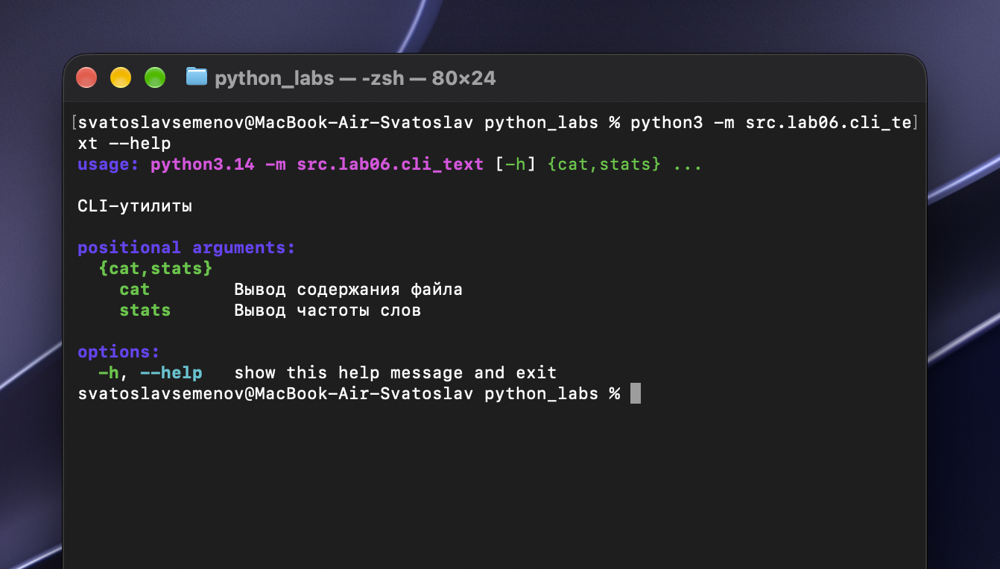 

## Вывод cтрок файла cat()
--input - путь к входному файлу  
-n - если нужно нумеровать строки  

people.csv  
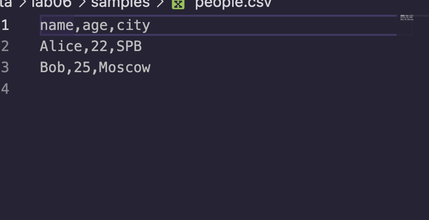 

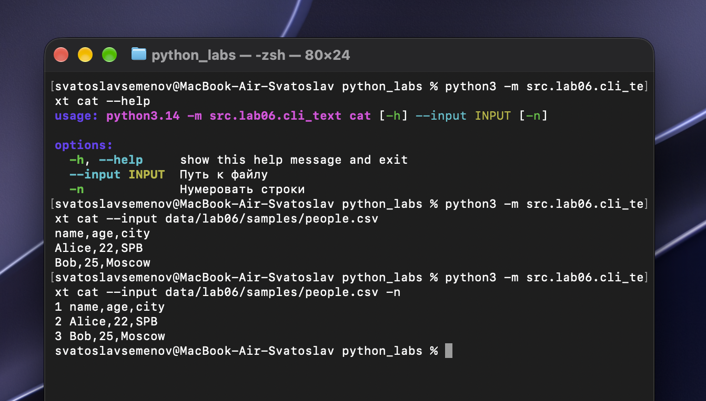


### Вывод топ слов stats()
--input - путь к входному файлу  
--top - количество слов для вывода (по умолчанию 5)  
peopletxt
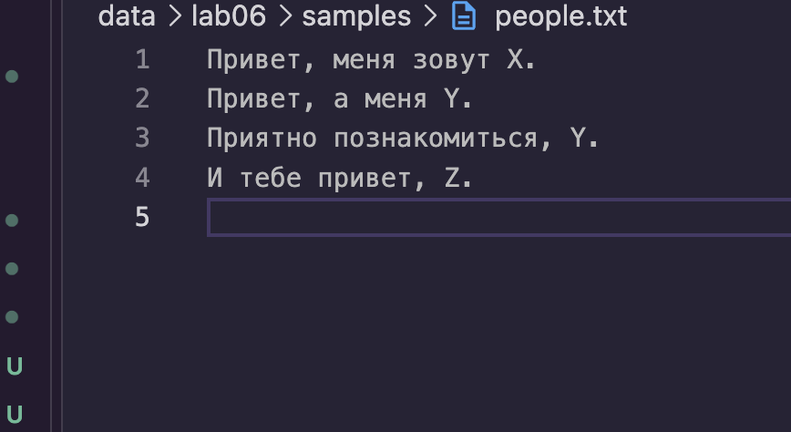  

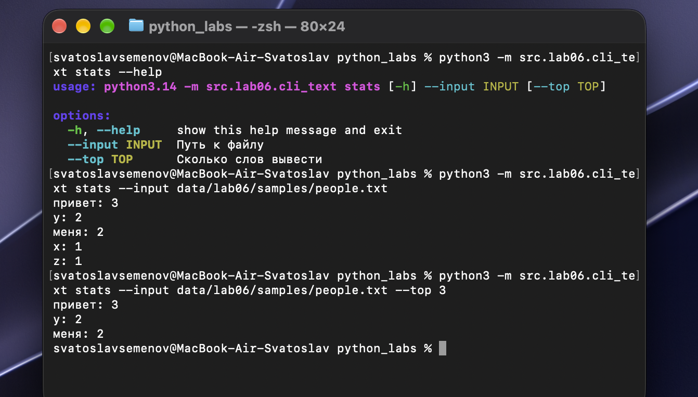  


## cli_convert.py
```py
import argparse

from src.lab05.json_csv import json_to_csv, csv_to_json
from src.lab05.csv_xlsx import csv_to_xlsx


def main():
    parser = argparse.ArgumentParser(description="Конвертеры данных")
    sub = parser.add_subparsers(dest="command")

    p1 = sub.add_parser("json_to_csv", help="JSON в CSV")
    p1.add_argument("--in", dest="input", required=True, help="Входной файл.json")
    p1.add_argument("--out", dest="output", required=True, help="Выходной файл.csv")

    p2 = sub.add_parser("csv_to_json", help="CSV в JSON")
    p2.add_argument("--in", dest="input", required=True, help="Входной файл.csv")
    p2.add_argument("--out", dest="output", required=True, help="Выходной файл.json")

    p3 = sub.add_parser("csv_to_xlsx", help="CSV в XLSX")
    p3.add_argument("--in", dest="input", required=True, help="Входной файл.csv")
    p3.add_argument("--out", dest="output", required=True, help="Выходной файл.xlsx")

    args = parser.parse_args()

    try:
        if args.command == "json_to_csv":
            json_to_csv(args.input, args.output)
        elif args.command == "csv_to_json":
            csv_to_json(args.input, args.output)
        elif args.command == "csv_to_xlsx":
            csv_to_xlsx(args.input, args.output)
        else:
            parser.print_help()
    except FileNotFoundError:
        print("Файл не найден")


if __name__ == "__main__":
    main()
```

### --help
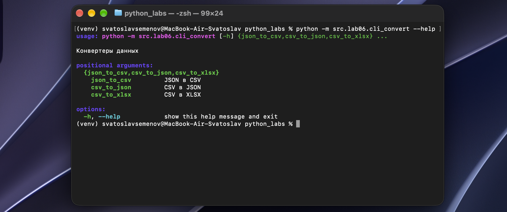

### json_to_csv
--in - путь к входному файлу  
--out - путь к выходному файлу  
#### --help 
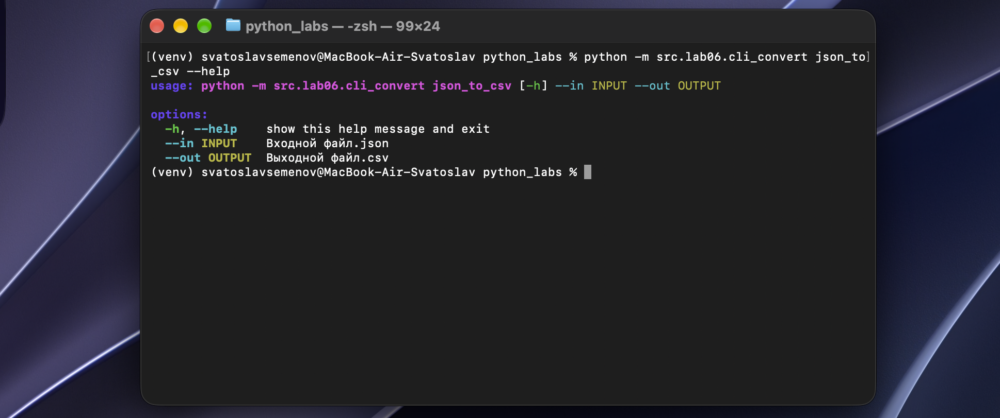

#### people.json -> people.csv
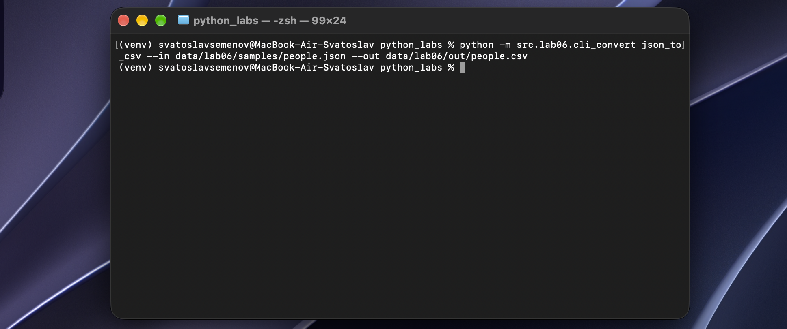
---
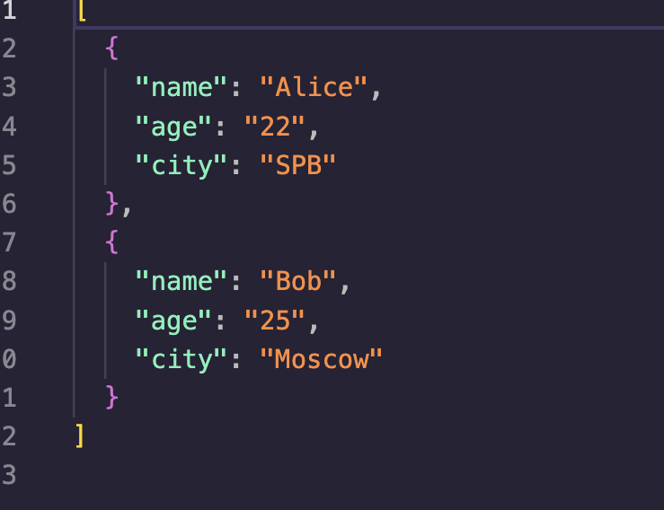
---
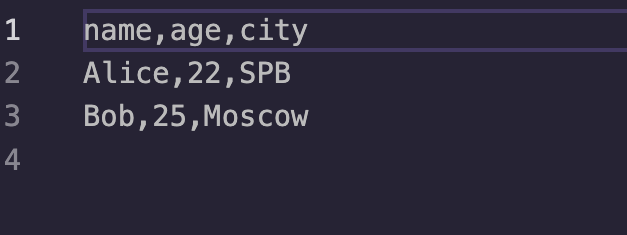


### csv_to_json
--in - путь к входному файлу  
--out - путь к выходному файлу  
#### --help 
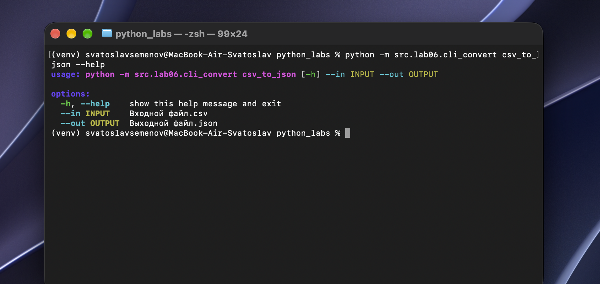

#### people.csv -> people.json
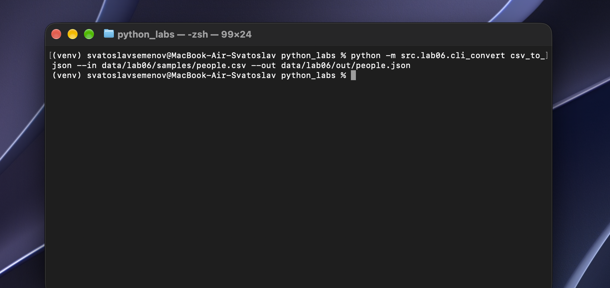
---
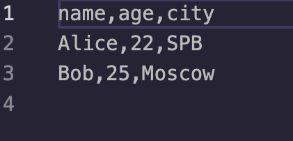
---
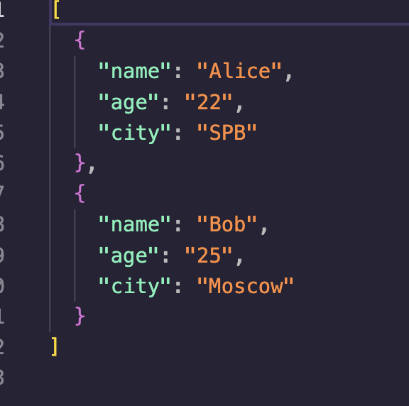


### csv_to_xlsx
--in - путь к входному файлу  
--out - путь к выходному файлу  
#### --help 


#### people.csv -> people.xlsx
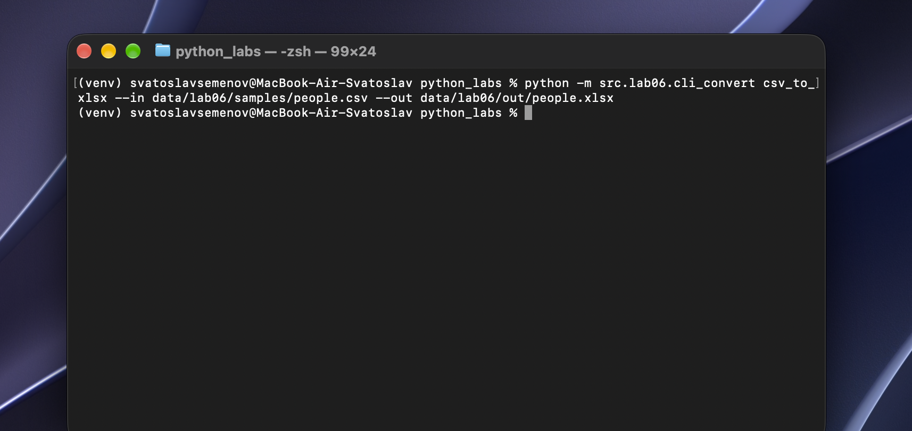
---
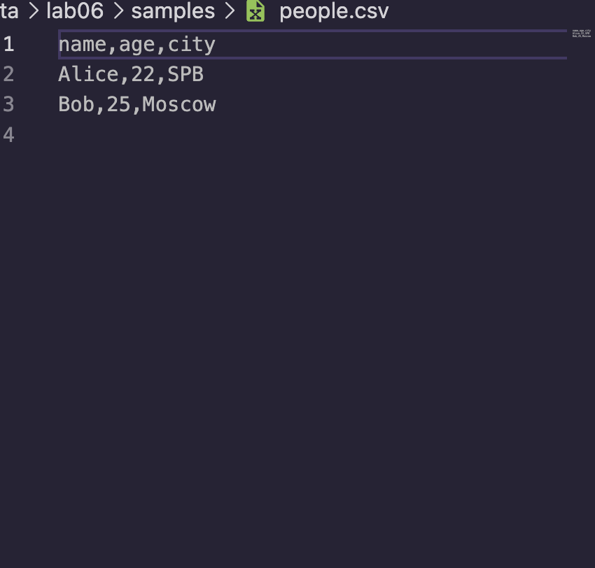
---
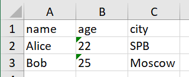

